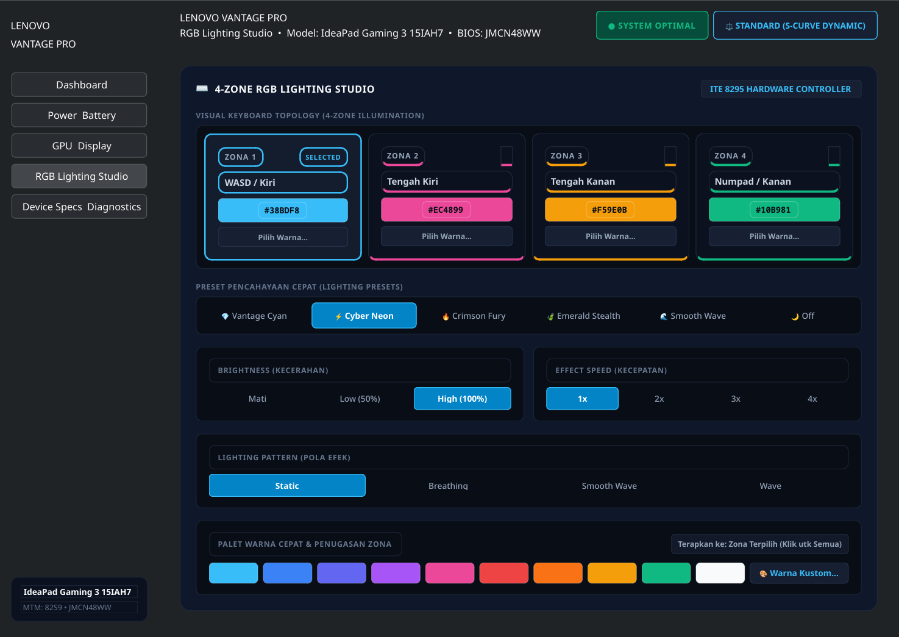
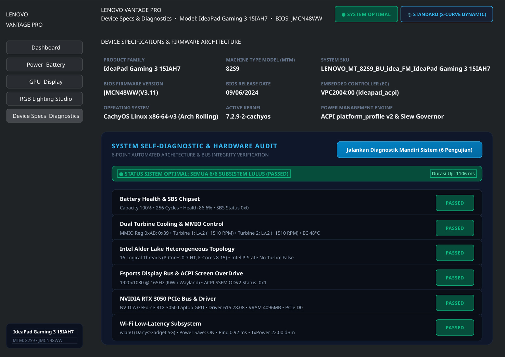
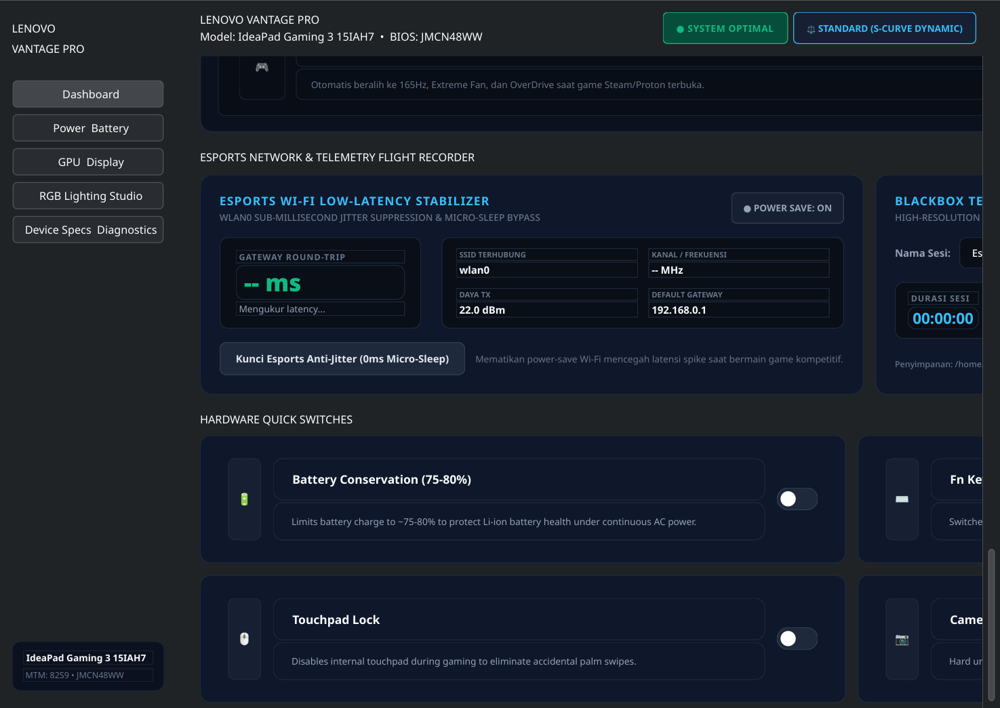
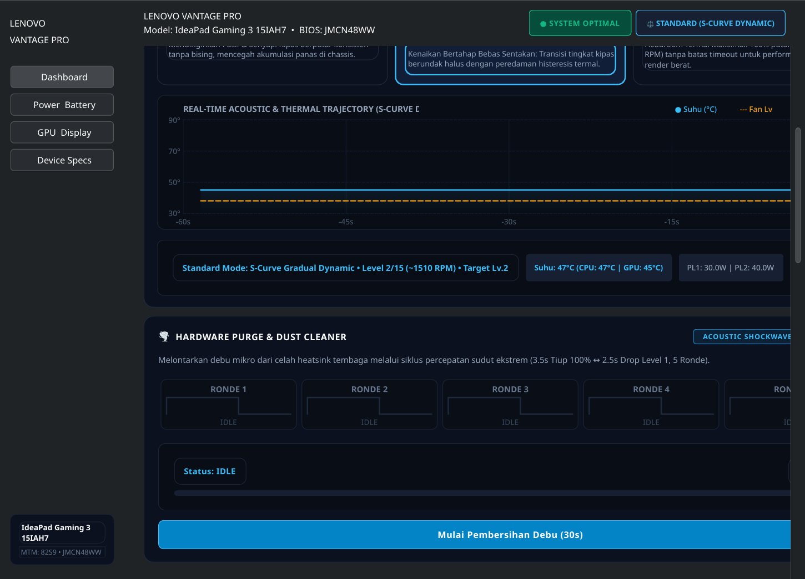
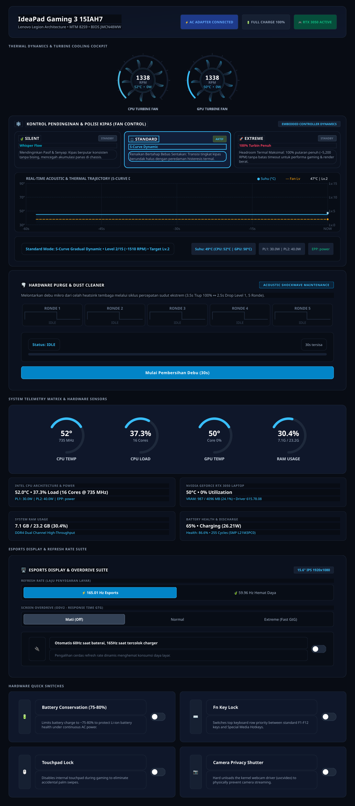
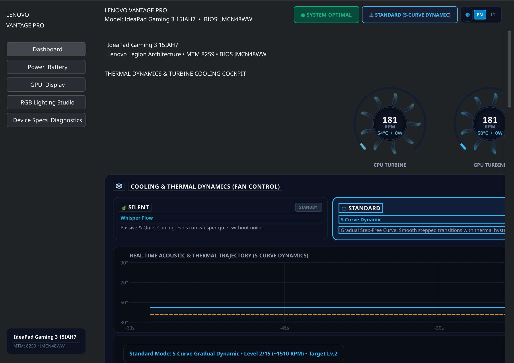
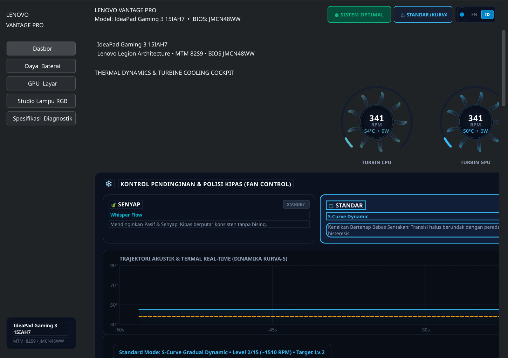
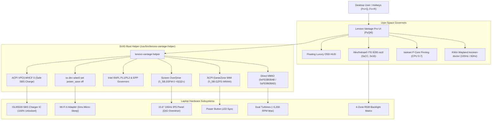

# Lenovo Vantage Pro (v0.5.0)

[](https://github.com/DanBuzZZ/lenovo-vantage-pro/releases)
[](https://www.gnu.org/licenses/gpl-3.0)
[](https://cachyos.org)
[](https://python.org)
[](https://riverbankcomputing.com/software/pyqt/)
[](./helper/helper.c)

**Lenovo Vantage Pro** is an open-source, enterprise-grade Hardware Control Center, Esports Suite, and Performance Optimizer engineered natively for Linux (CachyOS, Arch Linux, Fedora, Ubuntu, Debian, openSUSE). 

Designed specifically for modern Lenovo gaming laptops—including the **IdeaPad Gaming 3 (15IAH7 / 15ARH7)**, **Lenovo Legion (5 / 5 Pro / 7 / Slim)**, and **Lenovo LOQ** series—this software replaces bloated proprietary utilities with a lightweight, instantaneous PyQt6 vector interface running on an **Obsidian Titanium & Cyber Precision** design system with WCAG AAA accessibility.

---

## Visual Showcase

### 1. 4-Zone RGB Lighting Studio
Direct USB HID hardware IOCTL communication with the ITE 8295 keyboard controller (`048d:c973`), featuring interactive per-zone color assignment, instant luxury presets, speed, and brightness control:


### 2. Automated 6-Point Hardware Diagnostic Suite
Integrated self-diagnostic engine verifying battery health, SBS registers, dual MMIO cooling turbines, Intel Alder Lake hybrid topology, ACPI Screen OverDrive bus, NVIDIA RTX 3050 PCIe link, and Wi-Fi latency:


### 3. Esports Network Latency Stabilizer & Blackbox Flight Recorder
0ms micro-sleep suppression for zero ping jitter during competitive gaming, paired with a 1 Hz high-resolution telemetry blackbox logger:


### 4. Dedicated Heatsink Purge & Dust Cleaner Cockpit
5-round high-g angular acceleration shockwave cycle (3.5s blast @ 5,200 RPM $\leftrightarrow$ 2.5s drop @ 1,200 RPM) for clearing micro-debris from copper cooling fins, with automatic pre-purge mode restoration:


### 5. Floating Luxury On-Screen Display (OSD HUD)
Hardware-accelerated translucent floating HUD delivering instant feedback when switching thermal profiles (`Fn+Q`) or locking refresh rates (`Fn+R`):
<p align="center">
  
  
</p>

### 6. Full Dashboard Overview
Complete device telemetry, dual 60 FPS aerodynamic turbine tachometers, S-Curve dynamic thermal trajectory, and hardware quick switches:


### 7. Real-Time Bilingual Internationalization (English & Bahasa Indonesia)
Interactive language switcher (`[ 🌐 EN | ID ]`) accessible directly in the top header and system tray menu. Instantly localizes all 15 modules without needing an application restart:
<p align="center">
  
  
</p>

---

## The 15 Modern Flagship Modules

| # | Module | Hardware Mechanism & Implementation |
|---|---|---|
| **01** | **Dedicated Heatsink Purge Cockpit** | Isolated maintenance drawer executing 5 rounds of square-wave pulsation (3.5s @ 100% ~5,200 RPM $\leftrightarrow$ 2.5s @ Lv.1 ~1,200 RPM) with automatic profile restoration. |
| **02** | **Esports Display Suite** | Instant sub-second refresh rate locking (165.01 Hz $\leftrightarrow$ 59.96 Hz) via KWin Wayland `kscreen-doctor` and Smart AC/DC auto-switch. |
| **03** | **Screen OverDrive (ODV2)** | 3-stage gray-to-gray response time optimization via ACPI `\_SB.SSFM 0 <0\|1\|2>` followed by commit notification `\_SB.SSFM 1 0`. |
| **04** | **4-Zone RGB Lighting Studio** | Direct USB HID Feature Report (`HIDIOCSFEATURE(33)`) for ITE 8295 (`048d:c973`) via `/dev/hidraw*` with state persistence. |
| **05** | **Intel Alder Lake Hybrid Scheduler** | P-Core game process pinning (`taskset -cp 0-7 <pid>`) preventing Linux scheduler jitter across heterogeneous P/E cores. |
| **06** | **Intel No-Turbo Quiet Governor** | Direct sysfs hardware boost toggle (`intel_pstate/no_turbo`) maintaining CPU temperatures below 45°C during emulation and light tasks. |
| **07** | **Auto-Game Detection Engine** | Low-overhead daemon monitoring Steam, Proton, Wine, CS2, Apex, and Lutris processes with automatic profile engagement. |
| **08** | **Global Hotkeys & Floating OSD** | Sub-system event listener for `/dev/input/event11` and ACPI `platform_profile` polling with translucent PyQt6 HUD feedback. |
| **09** | **Low-Latency Wi-Fi Ping Stabilizer** | Sub-millisecond jitter suppression bypassing wireless radio micro-sleep (`iw dev wlan0 set power_save off`). |
| **10** | **Blackbox Gaming Flight Recorder** | 1 Hz telemetry logger writing session CSV and JSON summary files with peak thermal and RPM tracking. |
| **11** | **Automated Hardware Diagnostic Suite** | 6-point automated hardware integrity audit returning comprehensive health scorecards and sub-system verification. |
| **12** | **Hardware Quick Switches** | Zero-password instant toggles for Battery Conservation (75–80%), Fn-Lock, Touchpad Disable, and Camera Privacy Shutter. |
| **13** | **Battery Protection Guardrail** | Safe SBS IC ISL95520 management ensuring ACPI `MHCF = 0` to permanently eliminate charging cutoffs. |
| **14** | **Zero-Password Security Architecture** | Dedicated C SUID helper (`4755 root:root`) and udev rules eliminating Polkit password prompts entirely. |
| **15** | **Real-Time Bilingual i18n Engine** | Instantaneous (<5ms) dynamic runtime language switching between English and Bahasa Indonesia with persistence in `~/.config/lenovo-vantage/config.json`. |

---

## Deep Technical Architecture & Reverse Engineering

### Why Legacy Tools Failed on 2022+ Laptops
Earlier Linux utilities relied on writing to `/sys/bus/platform/drivers/ideapad_acpi/VPC2004:00/fan_mode` (calling ACPI `VPCW` with command `0x11` / `VPCCMD_W_FAN`). On 2022+ Lenovo IdeaPad Gaming and Legion BIOSes (e.g., `JMCN48WW`), this method was decommissioned by Lenovo into a **NO-OP** (`VDAT = 0x0B; VCMD = 0; Return (0)`). Writing to it caused EC desynchronization and failed to ramp the fans.

### The Modern Solution
Lenovo Vantage Pro bypasses legacy bottlenecks through a three-layer hardware pipeline:



---

## Hardware Compatibility

### Verified & Validated Hardware
- **Primary Testbed**: Lenovo IdeaPad Gaming 3 15IAH7 (Model `82S9`, BIOS `JMCN48WW`)
- **CPU**: Intel Core i5-12500H (12 Cores / 16 Threads: 4 Performance Cores @ 4.5 GHz + 8 Efficient Cores)
- **GPU**: NVIDIA GeForce RTX 3050 Laptop GPU (85W TGP Unlocked, PCIe D0/D3 Cold) + Intel Iris Xe (i915)
- **Display**: 15.6" Full HD (1920x1080) IPS 165.01 Hz / 59.96 Hz
- **Keyboard**: USB `048d:c973` Integrated Technology Express (ITE 8295) 4-Zone RGB Backlight
- **Battery**: SMP Li-ion `L21M3PC0` (45 Wh design, SBS controller ISL95520)

### Broad Device Compatibility
Compatible with the following chassis families running modern Linux kernels (5.15+ through 6.x / 7.x):
- Lenovo IdeaPad Gaming 3 Series (15IAH7, 15ARH7, 16IAH7, 16ARH7)
- Lenovo Legion 5 / 5 Pro Series (2020, 2021, 2022, 2023, 2024)
- Lenovo Legion 7 / 7i / Slim Series
- Lenovo LOQ 15 / 16 Series
- Select Clevo / Sager laptops sharing the ITE 8295/8291 RGB keyboard controller

---

## Installation & Setup

### Prerequisites
- Python 3.10 or newer
- PyQt6 (`python-pyqt6` or `python3-pyqt6`)
- `psutil`, `evdev`, `iw`, `gcc`, `make`

### Option 1: Automated Installer (Recommended)
Clone the repository and run the automated installer:
```bash
git clone https://github.com/DanBuzZZ/lenovo-vantage-pro.git
cd lenovo-vantage-pro
sudo ./install.sh
```

The installer will:
1. Detect your package manager and install dependencies.
2. Compile and install the SUID hardware helper to `/usr/bin/lenovo-vantage-helper`.
3. Configure non-root udev rules in `/etc/udev/rules.d/99-lenovo-vantage.rules`.
4. Install application files to `/opt/lenovo-vantage/`.
5. Install desktop shortcuts and application icons.

### Option 2: Arch Linux / CachyOS (PKGBUILD)
Build and install via `makepkg`:
```bash
git clone https://github.com/DanBuzZZ/lenovo-vantage-pro.git
cd lenovo-vantage-pro
makepkg -si
```

### Option 3: Manual Compilation
```bash
make
sudo make install
```

---

## Keyboard Shortcuts

| Shortcut | Action | Description |
|---|---|---|
| `Fn + Q` | **Thermal Profile Cycle** | Cycles through `Silent (Quiet)` $\leftrightarrow$ `Standard (Balanced)` $\leftrightarrow$ `Extreme (Performance)` with LED and OSD feedback. |
| `Fn + R` | **Refresh Rate Toggle** | Toggles panel refresh rate between `165.01 Hz Esports` and `59.96 Hz Power Saver`. |
| `Fn + F10` | **Touchpad Lock** | Hardware lock for internal touchpad. |
| `Fn + Space` | **RGB Profile Cycle** | Cycles saved RGB keyboard lighting profiles. |

---

## Uninstallation
To completely remove Lenovo Vantage Pro from your system:
```bash
cd lenovo-vantage-pro
sudo ./uninstall.sh
```

---

## Security & Safety Guardrails

- **Zero-Password Privilege Model**: All hardware operations are executed via a compiled C binary with minimal SUID permissions and udev matching rules. No broad root permissions or recurring Polkit popups.
- **Battery Safety Assurance**: The application enforces `MHCF = 0` on every invocation to prevent the Embedded Controller from entering Battery Firmware Flash Mode, ensuring safe, continuous battery charging.

---

## Development Sources, Lineage & Technical References

Lenovo Vantage Pro builds upon and synthesizes crucial reverse engineering research and open-source foundations from the Linux hardware community:

1. **Ancestral Lineage & Early Predecessors**:
   - **[niizam/vantage](https://github.com/niizam/vantage)** *(by Nizam & Lanchon)*: The original bash + zenity utility that laid the foundational groundwork for Lenovo battery conservation mode on older Linux installations.
2. **OEM Firmware Reverse Engineering**:
   - **Lenovo Vantage Windows Suite Decompilation**: Deep reverse engineering of `Lenovo.Vantage.GamingAddin` and `Lenovo.Modern.ImController` from Windows installations.
   - **ACPI DSDT/SSDT AML Disassembly**: Extracted and disassembled bytecode (`dsdt.dsl` and `SSDT4.dsl`) from Lenovo IdeaPad Gaming 3 15IAH7 (MTM `82S9`, BIOS `JMCN48WW`), discovering the modern **ACPI WMI GameZone** interface (`\_SB.GZFD.WMAA` arg `0x2C`) and **Screen OverDrive** registers (`\_SB.SSFM 0 <level>` + commit `\_SB.SSFM 1 0`), while exposing the legacy ACPI `0x11` (`VPCCMD_W_FAN`) NO-OP dead-end.
   - **SBS Battery Charger IC ISL95520 Guardrail**: Identification and neutralization of the ACPI `MHCF` battery firmware flash-trap that previously caused battery charging cutoffs at 3%.
3. **Embedded Controller (EC) & Fan Direct Control**:
   - **[lenovo-legion-linux](https://github.com/johnfanv2/lenovo-legion-linux)** *(by johnfanv2 and sparx)*: Architectural insights into direct memory-mapped I/O (MMIO) Embedded Controller manipulation (Base `0xFE0B0000`, Offset `0x800`), mapping registers `0xAB` (thermal mode control) and `0xAD` (turbine speed level 1–15).
4. **4-Zone RGB Keyboard Protocol**:
   - **[4JX/L5P-Keyboard-RGB](https://github.com/4JX/L5P-Keyboard-RGB)** *(by 4JX)* & **[HughScott2002/Aurora-Legion](https://github.com/HughScott2002/Aurora-Legion)**: Reverse engineered protocol specifications for Integrated Technology Express (ITE Tech) IT8295/IT8291 USB RGB controllers (`048d:c973`), defining the 33-byte HID Feature Report format (`HIDIOCSFEATURE`, Report ID `0xCC`, Command `0x16`).
5. **Linux Kernel & Wayland Ecosystem Integration**:
   - **KDE Plasma 6 / KWin Wayland**: Leveraging `kscreen-doctor` for zero-restart, sub-second display mode and refresh rate switching.
   - **Intel P-State & Taskset**: Linux kernel heterogeneous CPU optimization for Intel 12th Gen Alder Lake (4P + 8E), pinning critical gaming workloads to Golden Cove P-Cores (`CPU 0–7`) and locking clock boost via `intel_pstate/no_turbo`.
   - **Linux Wireless Subsystem (`iw`)**: Power-save radio management for eliminating 802.11 beacon sleep-cycle ping jitter.

---

## Authors & Maintainers

- **DanBuzZZ** ([@DanBuzZZ](https://github.com/DanBuzZZ)) — System Architecture, Reverse Engineering, UI/UX Pro Max Engineering, Hardware Drivers & Full Modernization.
- Thanks to the **CachyOS** and **Arch Linux** communities for cutting-edge kernel support, testing, and feedback.

---

## License

This project is licensed under the **GNU General Public License v3.0 (GPL-3.0)**. See the [LICENSE](LICENSE) file for complete details.
